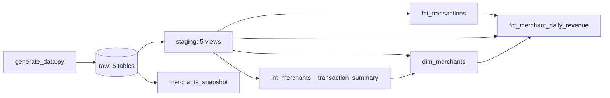

# payments-dw

A small payments data warehouse on **BigQuery and dbt**, built to learn the stack a payments company runs
and to practise working with an AI coding agent under written rules.

The business is made up: a card-payments processor whose merchants take transactions, issue refunds,
receive chargebacks and get paid out. The data is synthetic (500 merchants, 90 days, about 143,000
transactions). The engineering is meant to be real: layered models, tests on every model, incremental
partitioned facts, pull requests and CI.

## What's in it



| Layer | Models | Notes |
|---|---|---|
| Raw | `merchants`, `transactions`, `refunds`, `chargebacks`, `payouts` | Loaded by `scripts/generate_data.py`. Transactions have a nested `card` STRUCT and a repeated `line_items` array. |
| Staging | one `stg_payments__*` view per raw table | Rename and cast only. No joins, no business logic. |
| Intermediate | `int_merchants__transaction_summary` | Approved-only lifetime activity per merchant. |
| Marts | `dim_merchants` | One row per merchant, including those that never transacted. |
| | `fct_transactions` | One row per transaction. Incremental, partitioned by date, clustered by merchant. |
| | `fct_merchant_daily_revenue` | One row per merchant per day. Incremental. Built from a spec with the `/new-mart` skill. |
| Snapshot | `merchants_snapshot` | History of merchant plan and status changes (SCD2). |

9 models, 1 snapshot and 138 tests. `dbt build` runs in about a minute.

## Design decisions

**Layering is enforced by folder.** `dbt_project.yml` sets the materialization and dataset per folder, so a
model gets the right behaviour from where it is saved. Staging and intermediate are views. Marts are tables by default, and the two facts override that to incremental.

**Money is stored as integer cents.** Integers add exactly. Dollars are a display concern.

**Facts are incremental with `insert_overwrite` on a date partition.** Each run rebuilds only the partitions
inside a lookback window. The window is set by how late related data can arrive for the date it is attributed to:

- `fct_transactions` carries each transaction's refund total, and refunds arrive up to 14 days after the sale,
  so it reprocesses 14 days.
- `fct_merchant_daily_revenue` counts a refund on the day the refund was created, so old days never change
  because of refund lag. It reprocesses 3 days, which only has to cover late loads.

The same refund needs a 14-day window in one model and a 3-day window in the other.

**Measured, not assumed.** On this data a full build of `fct_merchant_daily_revenue` scans 4.7 MiB and an
incremental run scans 443 KiB. For `fct_transactions` it is 14.0 MiB against 6.0 MiB, and the incremental run is
slower, because a multi-statement script has fixed overhead that dominates at this size. Incremental pays off
when a full rebuild costs real money, not before.

**The daily table is built on a spine.** Transactions, refunds and chargebacks are each aggregated to
merchant and day, the keys are unioned, and the aggregates are joined onto that. Starting from transactions
would drop the days that have a refund or chargeback but no sales. This data has 431 of those.

**Tests guard decisions as well as data.** Row-count tests against staging protect the joins in `dim_merchants`
and `fct_transactions` from dropping or duplicating rows. `not_null` on coalesced columns protects the coalesce. Business rules are tested where
analysts read the data, for example `refunded_amount_cents <= amount_cents`.

**Least privilege.** dbt runs as a service account with BigQuery Data Editor and Job User, not Admin.

## Working with a coding agent

The agent's rules are part of the repo:

- `CLAUDE.md` holds the conventions for layering, naming, SQL style and required tests. It is loaded in every session.
- `.claude/skills/` holds four procedures the agent runs on request:
  - `/new-source <table>` builds a tested staging model from a raw table.
  - `/new-mart <spec>` builds a tested mart from a spec file in `specs/`.
  - `/add-tests <model>` profiles a model and proposes tests before writing them.
  - `/review-model <model>` reviews a model against `CLAUDE.md`.
- `specs/` holds the spec a mart is built from: grain, inputs, columns, config, tests and what is out of scope.

How the work was split. I built this with Claude as a pair, and I was learning dbt and BigQuery as I went.
Claude drafted the scaffold: the data generator, the project config, the first staging model, `CLAUDE.md` and
the first three skills. For the refunds model, the intermediate model, `dim_merchants` and `fct_transactions`,
I wrote the first drafts and Claude reviewed and corrected them, including most of the test YAML. Claude
drafted the daily-revenue spec and we revised it over several rounds. I put together the `/new-mart` skill
from steps we worked out together, ran it to build `fct_merchant_daily_revenue`, and fixed the skill from what
the first run got wrong. I ran every command, approved every agent edit one at a time, and every change after
the scaffold went through a pull request.

What I learned from running it:

- **A skill edit is a code change.** We added a rule that columns marked nullable in the schema get no
  `not_null` test. The agent applied it exactly and dropped valid tests, because BigQuery marks almost every
  column nullable. The rule now says to decide from the data and what the column means.
- **Stop-and-ask rules work.** On the first `/new-mart` run the agent stopped on a real conflict: the spec's
  model name broke the `fct_`/`dim_` prefix rule in `CLAUDE.md`. It asked instead of picking one.
- **The agent finds data bugs if you let it report them.** It found pending chargebacks that had a resolution
  date, and later chargebacks dated in the future. Both were generator bugs. Both are fixed and now have tests.
- **The spec is where most of the judgement goes.** The first draft of the daily-revenue spec had a test that
  would always fail, a time window with no reference point and a join order that dropped rows. Fixing the spec
  first was cheaper than fixing the model.
- **Check that a requested change landed.** The agent once reported done without making a correction I had
  asked for. I now ask directly and read the diff.

`docs/learning-log.md` has the day-by-day notes, including the mistakes.

## CI

Every pull request runs `dbt build --full-refresh` on GitHub Actions against a separate `dbt_ci` dataset. It
builds from scratch on purpose. An earlier version reused tables left by previous runs, and after a data reload
the row-count test caught a fact table that mixed old and new data.

## Run it

You need a GCP project with BigQuery and a service account with BigQuery Data Editor and Job User.
`docs/SETUP.md` has the full steps.

```bash
python3 -m venv .venv && source .venv/bin/activate
pip install -r requirements.txt
cp profiles.yml.example ~/.dbt/profiles.yml     # edit project and keyfile
export GOOGLE_APPLICATION_CREDENTIALS=~/.gcp/dbt-runner.json
export GCP_PROJECT=<your-project-id>

python scripts/generate_data.py --merchants 500 --days 90
dbt deps
dbt build
```

After reloading the raw data, run `dbt build --full-refresh`. Incremental tables keep partitions outside
their lookback window, so they would otherwise mix old and new data.

## Known limits and what's next

- `plan` and `industry` in `fct_merchant_daily_revenue` are copied in when a partition is built and are not
  updated if a merchant changes later. Join `dim_merchants` for current values. The fix is to drop them from
  the fact or use the snapshot for as-of values.
- Chargebacks can arrive about 60 days after a sale and are not reflected in `fct_transactions`.
- The raw refund and chargeback tables are not partitioned, so the incremental filter does not reduce what is
  scanned from them.
- Authentication uses a service-account key file. Next step is impersonation for local work and Workload
  Identity Federation for CI, so no long-lived key exists.
- CI rebuilds everything. A larger project would build only changed models in a schema per pull request.
- Not built yet: orchestration (Airflow), ingestion (Airbyte) and running any of it on Kubernetes.

## Repo layout

```
models/staging/payments/   staging models, sources and tests
models/intermediate/       reusable joins and aggregations
models/marts/              dimension and fact tables
snapshots/                 merchant history
tests/                     business-rule tests written as SQL
macros/                    cents_to_dollars, dataset naming
scripts/generate_data.py   synthetic data loader
specs/                     mart specs
.claude/skills/            agent skills
CLAUDE.md                  project conventions
docs/                      setup, decisions, learning log
```
